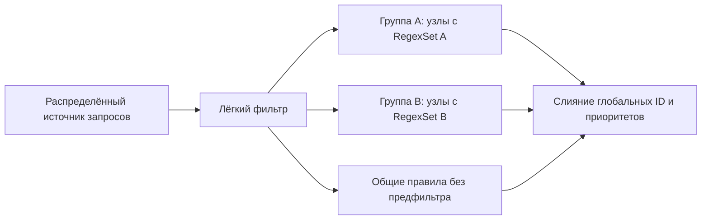

# Текущая реализация: разделение правил

Основной `fast` автоматически делит поддержанные правила между N отдельными
RegexSet. Reader рассылает каждый батч всем воркерам; writer объединяет глобальные
ID правил и применяет приоритет probe, дедупликацию сервисов и hard-over-soft.
Наборы не пересекаются, каждое правило проверяется для каждого запроса.
Разбиение зависит от правил и N, без ручной настройки под корпус.
Прежнее распределение запросов описано ниже, в разделе «Почему изменена схема».
[Команды запуска, тестов и профилирования](running.md) вынесены отдельно.

Байты батча разделяются через `Arc`; файлы сортируются и читаются потоково.
Батч — до 256 запросов / примерно 1 MiB; большой запрос может превышать лимит.
У каждого воркера входной и выходной канал по два батча; ожидание всех ответов
создаёт backpressure. Кэш lazy DFA ограничен 128 MiB на рабочий кэш, а не на
процесс; память выделяется по необходимости, готовые ответы не кэшируются.

## Полные замеры без профилировщика

Apple M3 / Mac15,13, 16 GiB, 8 физических и логических ядер: четыре P и четыре E.
Rust 1.93.0; release с thin LTO и одним codegen unit. Привязки потоков к ядрам нет;
`--workers N` создаёт N потоков поиска, дополнительно работают reader и writer.
Аппаратная конфигурация повторно проверена через sysctl.

Все конфигурации используют один бинарник с SHA-256
`23aa691093ca8c16dbae5d1e7679144f8775704998f55a8802cffa3cb94859ca`.
Полный отсортированный корпус — 1 114 166 запросов / 5 365 209 223
нормализованных байта. По одному новому процессу, без прогрева, профилировщика,
affinity и сброса файлового кэша ОС. Подготовка, JSONL и финальный flush включены,
`fsync` нет. Проверка результатов выполняется после измерения.

| Воркеры | Подготовка, с | Конвейер, с | Всего, с | req/s | S(N) |
|---:|---:|---:|---:|---:|---:|
| 1 | 0,378 | 575,326 | 575,704 | 1 935 | 1,00× |
| 2 | 0,582 | 54,221 | 54,803 | 20 331 | 10,51× |
| 4 | 0,561 | 29,524 | 30,085 | 37 035 | 19,14× |
| 8 | 0,411 | 27,650 | 28,060 | 39 706 | 20,52× |

2/4/8 измерены раньше в тот же день, 1 — отдельным последующим запуском без
пересборки. [Сводный отчёт](../results/benchmark.json) содержит параметры исходных
серий, SHA-256 и все измеренные запуски; промежуточные отчёты удалены после
объединения. Предыдущие значения не подставляются вместо текущего fast/1.
575,704 против прежних 592,879 с — −2,90% времени / +2,98% throughput.
По одному запуску это наблюдение, не установленное устойчивое улучшение.

`S(N)=T_fast(1)/T_fast(N)` здесь включает влияние размера автомата на стоимость
вычислений. Значения больше N не доказывают чистую эффективность дополнительных
ядер. Переходы 2 → 4 и 4 → 8 дают 1,82× и 1,07×: линейность на всём диапазоне
не достигнута. Восемь дают лучшее измеренное время, четыре близки по throughput.

Дополнительная текущая серия — первые 10k, три повтора каждой конфигурации,
с чередованием порядка. Медианы 1/2/4/8: 5,925 / 2,257 / 1,446 / 0,710 с;
каждый вывод сравнивался с отдельным baseline на этих же 10k.
Наивный baseline на 100k из прошлой серии — 40,239 с; исходный исторический
JSON-отчёт в текущем каталоге отсутствует. Это историческое значение,
оно не используется как знаменатель для новых серий.

## Новое независимое сравнение на 100k

В `baseline_comparison_100k` [benchmark.json](../results/benchmark.json) сохранены
пять новых последовательных запусков: baseline/1, затем fast/1/2/4/8.
Использован тот же неизменённый release-бинарник, что и для полного корпуса.
По одному свежему процессу, одинаковые первые 100 000 запросов,
417 530 913 нормализованных байт; из них 99 999 с совпадением сервиса.
Все эти запросы — Legitimate вследствие сортировки путей, не случайная смесь
двух классов. Условия времени те же: подготовка и реальный вывод включены,
профилировщика, affinity, явного прогрева и сброса кэша ОС нет.

| Режим | Воркеры | Подготовка, с | Конвейер, с | Всего, с | req/s | S к baseline |
|---|---:|---:|---:|---:|---:|---:|
| baseline | 1 | 0,238 | 48,470 | 48,708 | 2 053 | 1,00× |
| fast | 1 | 0,428 | 50,976 | 51,404 | 1 945 | 0,95× |
| fast | 2 | 0,569 | 5,857 | 6,426 | 15 561 | 7,58× |
| fast | 4 | 0,566 | 3,412 | 3,979 | 25 135 | 12,24× |
| fast | 8 | 0,398 | 1,762 | 2,159 | 46 314 | 22,56× |

Ускорение считается как `T_baseline(100k)/T_fast(100k)`, без сравнения разных
размеров корпуса. Fast/1 немного медленнее наивного baseline в этом измерении.
Один запуск не устанавливает устойчивость различий; старые 40,239 с не заменяют
новый baseline. Параметры, фактические команды, внешнее время процесса,
точные метрики и хеши сохранены в отчёте.

У всех пяти выводов каждый ID встретился ровно один раз; результаты по каждому ID,
число байт/запросов/совпадений и отчёты исключений совпали с baseline.
Digest этой выборки:
`d70c8538778c5a83db438549c14efc711ef4ae01a5cb7b25131afeef57a736a2`.
Проверка выполнялась вне измеряемого времени; временные JSONL удалены.
Эта серия не запускала полный корпус и не заменяла его предыдущие результаты.

## CPU-профили: 2 / 4 / 8

Instruments 27.0 (27A266a), CPU Counters / **Instruction Processing Bottlenecks**
и Time Profiler. По одному последовательному свежему процессу на полном корпусе.
Сборка с debug symbols размещена отдельно в `/private/tmp/http-matcher-profile-target`;
оптимизация release сохранена, обычный benchmark-бинарник не менялся.
Хеши исходников, обеих сборок и настройки —
[в итоговом отчёте](../results/experiments.json), раздел `profiling_environment`.

Начало анализа — первая разрешённая функция `process_batches` плюс пять секунд.
Это исключает начало работы воркеров, не считая служебную задержку запуска
Instruments частью работы приложения. Интервалы, пересекающие границу,
обрезаются с соответствующим весом. Конец — последний активный интервал процесса.

| Метрика после первых пяти секунд | 2 | 4 | 8 |
|---|---:|---:|---:|
| Длительность окна, с | 50,006 | 25,260 | 22,976 |
| Активный CPU процесса, с | 79,917 | 68,814 | 91,360 |
| Среднее занятых ядер процессом | 1,598 | 2,724 | 3,976 |
| Доля суммарного времени восьми ядер | 19,98% | 34,05% | 49,70% |
| Reader, доля одного ядра | 50,04% | 92,13% | 94,94% |
| Воркеры суммарно, в ядрах | 1,090 | 1,781 | 3,006 |
| Writer, доля одного ядра | 0,81% | 2,24% | 2,14% |
| Regex, inclusive доля Running-семплов воркеров | 99,76% | 99,47% | 99,14% |
| Построение переходов DFA, inclusive | 56,34% | 9,52% | 1,29% |
| Executing без критического промаха L1D | 90,15% | 94,25% | 96,44% |
| Critical L1D Cache Miss: остановка исполнения | 2,21% | 2,18% | 1,01% |
| Критический промах с продолжением исполнения | 1,96% | 1,81% | 1,95% |
| Активное время воркеров на E-ядрах | 0,26% | 18,97% | 48,77% |

CPU-секунды — сумма длительностей активных интервалов `CounterMetricByThread`.
Сумма может превышать wall-clock. Разделение на роли определяется по разрешённым
стекам `process_batches` / `read_batches` и главному потоку. Один занятый CPU
означает 100% одного ядра; доля восьми ядер относится к этому процессу, не к полной
занятости ноутбука, и не нормирует разную производительность P/E.

Time Profiler выдавал предупреждение: запрошенный период 5 ms отличался от
сконфигурированного 1 ms. Поэтому абсолютный вес семплов не используется как
CPU-секунды. Для функций считаются только доли одинаково взвешенных Running-семплов;
масштаб веса сокращается. Занятость считается независимо по активным интервалам.
Inclusive означает, что учитывается функция вместе с вызванными ею функциями:
семпл относится к regex, если regex присутствует где-либо в стеке.
Знаменатель обеих строк — активные Running-семплы только воркеров,
без reader, writer и ожидания очередей. Построение переходов уже входит в regex;
56,34% / 9,52% / 1,29% считаются от всего активного времени воркеров,
а не как отдельные проценты от 99%. Эти вложенные доли нельзя складывать.
При восьми воркерах 3,976 занятого ядра — примерно 49,70% времени восьми ядер,
а 99,14% — доля regex внутри активного CPU-времени воркеров.

Аппаратные отношения времени ожидания усредняются по длительности активных
интервалов. Знаменатель — циклы обработки с непустым окном инструкций, значения
выгрузки квантованы с шагом 1/10000. Это не процент wall-clock и не частота
промахов от числа обращений. Значение Executing также не равно cache hit rate:
процессор может выполнять другие инструкции при ожидающем промахе.
Определения — [Apple: Optimize CPU performance with Instruments](https://developer.apple.com/videos/play/wwdc2025/308/).

Времена под профилировщиком: 55,667 / 30,805 / 28,385 с. Они сохранены отдельно
и не заменяют обычные времена для throughput.

## Отдельные счётчики L1D Cache Metrics

Ещё по одному свежему процессу для 2/4/8 на том же полном корпусе, режим
**L1D Cache Metrics**, EL0. Здесь считается весь запущенный процесс, включая
подготовку, reader, regex-воркеры и writer; первые пять секунд не исключаются.
Суммируются значения `sum` таблицы `MetricTableForThread` по интервалам P/E.
Счётчики speculative: включают спекулятивную работу процессора.

| Метрика всего процесса | 2 | 4 | 8 |
|---|---:|---:|---:|
| Промахов загрузки L1D на 1000 load µops | 131,58 | 39,42 | 11,77 |
| Промахов записи L1D на 1000 store µops | 78,48 | 28,05 | 8,81 |

Исходные суммы загрузок, записей, промахов, writebacks и циклов, а также P/E
сохранены в `l1d_cache_metrics.runs` итогового отчёта. Микрооперация не обязана соответствовать
одному обращению к кэшу; эти отношения нельзя вычесть из 100%, чтобы получить
точный hit rate. Они описывают весь процесс, тогда как таблица остановок выше —
воркеры в другом окне и другом запуске. Доля попаданий/очисток программного
DFA-кэша также не измерена: семплирование не считает отдельные события очистки.

## Что теперь ограничивает масштабирование

При 2 воркерах один поднабор накопил 40,79 CPU-секунды, другой — 13,70.
При 4 диапазон — 9,09–14,98, при 8 — 0,95–11,28. Равное число правил не
гарантирует равную стоимость: writer ждёт все поднаборы, быстрые могут ждать
входа или освобождения ограниченной очереди.

При 4/8 reader занимает 92–95% одного ядра. По стеку он читает, разбирает JSON,
нормализует и рассылает батчи. Это указывает на близкий предел одной входной
стадии. Нормализация занимает около 1,7 с elapsed-времени вызовов на корпус;
это не CPU-разложение всей стадии. Исторический изолированный reader занял
24,846 с; он не запускался заново и относится к прошлой итерации.

Восемь воркеров после первых пяти секунд тратят суммарно 69,06 CPU-секунды,
четыре — 44,98, при близком wall-clock: повторные проходы по каждому запросу
увеличивают вычислительную работу. Текущая остановка исполнения из-за критических
L1D-промахов невелика; старое объяснение деградации восьми потоков большим
ожиданием памяти нельзя переносить на новую схему. RAM bandwidth, L2/TLB,
частоты, тепловые ограничения и задержки I/O отдельно не измерены.

Вывод: распределение правил резко уменьшило стоимость lazy DFA; следующая
работа — уменьшать ненужные проходы, балансировать стоимость поднаборов,
распределять чтение/парсинг. Низкий CPU writer по семплам не исключает ожидания
I/O; сравнения с выключенным выводом не было.

## Корректность и назначение результатов

Для нового fast/1 и всех шести профилированных прогонов проверены каждый ID,
количество запросов/байт/совпадений, списки `match`/`softmatch` и отчёт исключений.
Общий digest по ID:
`f9023dc74a7085cdf72d562a41fb1c614b6651afed5ea004fb6119fe7c8c9554`.
Все полные результаты совпали с эталоном fast; независимый baseline
проверялся на выборках, не на всём корпусе. Это не доказательство PCRE-эквивалентности
и не оценка качества распознавания атак.
После проверки исходные JSONL удалены; digest и результаты проверок сохранены.

| Класс корпуса | Запросов | С совпадением сервиса | Без совпадений |
|---|---:|---:|---:|
| Legitimate | 1 040 242 | 1 040 216 | 26 |
| Malicious | 73 924 | 73 924 | 0 |

Граница классов определяется сортировкой путей: все Legitimate раньше Malicious;
размеры классов соответствуют составу корпуса в ТЗ. `matched_requests` означает
непустой список сервисов, **не найденную атаку**. Программа не блокирует запросы.
Широкие Nmap-сигнатуры могут совпадать на обоих классах HTTP-запросов.

Поддержаны 11 267 из 12 172 правил, пропущены 905:
look-around — 685, квантификаторы — 93, группы — 82, possessive — 21,
backreferences — 16, классы — 8. Причины по каждому правилу сохранены в
[skipped-patterns.jsonl](../results/skipped-patterns.jsonl).
Baseline и fast используют одинаковый байтовый движок и отсев несовместимых
паттернов; Unicode выключен. Безопасный octal `\0xx` переводится в `\xHH`,
приблизительного перевода PCRE нет. Парсер извлекает probe, match/softmatch,
regex и флаги i/s; `rarity`/`fallback`, сетевые пробы и полная грамматика Nmap
не моделируются.

После слияния глобальных ID результат сортируется по порядку probe, затем
строке правила. Имена сервисов дедуплицируются с сохранением этого порядка;
hard match подавляет softmatch того же сервиса. Нормализация и JSONL описаны
в README и инструкции запуска; полноценного HTTP-парсера нет.

16 модульных тестов текущей схемы прошли до этих измерений; исходники Rust
с тех пор не менялись. Шесть тестов benchmark-скрипта проходят без запуска корпуса:
проверяют выбранные количества воркеров, сравнение результатов и сохранение
`skipped_report_sha256` для обоих анализаторов. CPU/L1D-анализаторы проверяют
роли потоков, форму счётчиков и совпадение вывода с полным fast-эталоном.

## Воспроизведение профилей

Все команды и требования вынесены в [инструкцию запуска](running.md).
Трассы, XML, логи и повторные JSONL текущих измерений удалены после проверки
и переноса результатов в `results/experiments.json`. Сохранены компактные
итоговые отчёты, методика, хеши выгрузок и два файла настроек Instruments.
Для повторного анализа исходных стеков и аппаратных интервалов потребуется
новая запись профилей. Анализаторы используют полный fast/1, если он есть
в benchmark-отчёте, иначе первый сохранённый полный fast.

## Почему изменена схема и что делать на 100M / 1B

В прошлой итерации каждый воркер получал только часть запросов, но проверял
полный RegexSet с отдельным рабочим кэшем. Полные времена 1/2/4/8:
592,879 / 396,402 / 509,190 / 575,548 с. Это исторические числа;
отдельные исходные отчёты предыдущей итерации в текущем каталоге отсутствуют.

Среди кэшей 64/128/256 MiB выбран 128 MiB; 256 MiB не дал убедительного
выигрыша, точный оптимум между проверенными значениями не исследован.
Общий `RwLock` также не дал убедительного выигрыша. Эти эксперименты относятся
к прежней схеме, а не к новому независимому сравнению 100k.

Профили на первых 200k показывали 99% CPU воркеров в regex,
97–99% в построении переходов lazy DFA и большой рост ожидания памяти при 8.
Поэтому были разделены сами правила, сохранив полную проверку каждого запроса.
Новые профили на полном корпусе подтверждают гораздо меньшую долю построения
переходов при 4/8. Старые и новые аппаратные проценты не объединяются в одну
кривую: корпуса/окна профилей отличаются.

Уменьшение каждого автомата резко снизило затраты на построение переходов:
при том же числе двух воркеров полный прогон сократился с 396,402 до 54,803 с.
Это результат текущего корпуса, а не обещание такого же выигрыша для всех правил.

Будущий вариант сначала можно проверить на одной машине: дешёвый фильтр по
признакам/обязательным литералам направляет запросы к подходящим RegexSet в
воркерах. Один дополнительный лёгкий проход предположительно окупится сокращением
повторных чтений байтов regex-движками; выигрыш зависит от отсева и ещё не измерен.
Исходные файлы всё равно читаются, а JSON разбирается для каждого запроса.
Затем тяжёлые специализированные группы можно распределить по устройствам:

Это предложение, не реализованный режим. Предфильтры строить из известных
правил, не из заранее известных запросов: отсутствие обязательного литерала
позволяет исключить соответствующее правило; наличие требует полного regex.
GET/POST сами по себе не дают права исключить другие сигнатуры. Для запроса
с несколькими подходящими группами нужны несколько маршрутов; правила без
безопасного предфильтра проверяются общим пулом.

Цель — оптимальная нагрузка и объём RegexSet на каждом устройстве. Балансировать
по стоимости/длине запросов, размеру очереди, времени поиска и рабочему набору;
горизонтально добавлять узлы к перегруженной группе, сохраняя полноту результатов.
Нужно распределить и входную JSON-стадию, иначе один reader сохранит ограничение.
Для 100M / 1B также нужны лимиты запросов, backpressure, версии правил,
устойчивые ID, политика повторов/дедупликации, контроль задержек и восстановление.
Программный кэш lazy DFA хранит состояния, а не готовые ответы:
[документация regex-automata](https://docs.rs/regex-automata/0.4.18/regex_automata/hybrid/index.html).

## Требования к сетевому потоку и восстановлению

Стенд моделирует вычислительную часть WAAP: файловый корпус заменяет сетевой
вход, каналы передают запросы тяжёлым фильтрам, writer собирает результаты.
В целевой системе проверенные запросы направляются серверу; ответ возвращается
клиенту. Сейчас reader рассылает запрос всем поднаборам правил; лёгкий фильтр
с выбором подходящих получателей и сетевая пересылка — будущие компоненты.

| Требование | Что потребуется для целевой системы |
|---|---|
| Лимиты размеров | Ограничивать размер запроса, тела и расход памяти очередей. Текущие 256 запросов / примерно 1 MiB ограничивают батч, но допускают отдельный запрос большего размера. |
| Backpressure | Замедлять вход при заполненных очередях и определить поведение при перегрузке. Сейчас ограниченные каналы уже заставляют reader ждать; между устройствами потребуется аналогичный механизм. |
| Ожидание и ошибки фильтров | Задать допустимое время ожидания проверки и поведение при таймауте или сбое. Объединение должно учитывать ответы всех необходимых поднаборов; частичный результат не считать полной проверкой. |
| Версии правил | Использовать согласованную версию правил на всех стадиях одного запроса и сохранять её вместе с результатом. Ревизия Nmap сейчас закреплена; управление обновлением нескольких узлов пока отсутствует. |
| Устойчивые ID | Связывать исходный запрос, задания фильтрам и итоговый результат одним ID, сохраняемым при повторной проверке и смене узла. Текущий порядковый ID воспроизводим при неизменном отсортированном корпусе. |
| Повторы и дедупликация | Повторять незавершённую проверку с теми же ID и версией правил; отличать повтор ответа одного поднабора от ответа другого поднабора. Сейчас удаляются дубли имён сервисов, а повторная обработка заданий не реализована. |

Повтор сигнатурной проверки и повторную отправку исходного HTTP-запроса серверу
нужно обрабатывать отдельно: повтор отправки может повторно выполнить действие
на сервере. Восстановление фильтра не должно автоматически означать повтор
уже отправленного запроса.

Для корпуса 100M / 1B нужны контрольные точки: позиция чтения и подтверждённые
результаты, чтобы после перезапуска продолжать с незавершённых заданий, без
потерь и дублей. Для живого потока отдельно определяется судьба запросов,
ожидающих проверки в момент сбоя, и восстановление работоспособности фильтров.
Таких механизмов в стенде нет; это предложения по развитию целевой WAAP.
